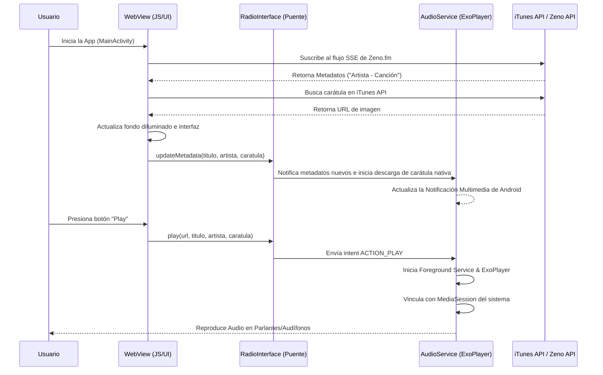

# Reporte Técnico: Aplicación de Radio "Sonido Celestial"

Este documento contiene un análisis técnico exhaustivo del proyecto **Sonido Celestial**, detallando su arquitectura, componentes principales, problemas identificados, riesgos de seguridad y un plan de mejoras a corto, mediano y largo plazo.

---

## 1. Resumen Ejecutivo

### Descripción General del Proyecto
**Sonido Celestial** es una solución híbrida de reproductor de radio en streaming diseñada para plataformas Web y Android. El núcleo de la interfaz de usuario se desarrolla en tecnologías web (HTML5, CSS3, JS) y se embebe dentro de una aplicación Android nativa mediante un componente `WebView`. Para asegurar una reproducción fluida, de alto rendimiento y en segundo plano, la reproducción de audio se delega a un motor nativo utilizando ExoPlayer en lugar del elemento de audio de HTML5.

### Tecnologías Utilizadas
* **Frontend Web (UI)**: HTML5, CSS3 (con fuente de Google Fonts 'Outfit', iconos de FontAwesome y un fondo animado tipo Starfield basado en `<canvas>`), Javascript vanilla (ES6).
* **Integración Web-Nativo**: Puente JavaScript (`JavascriptInterface`) expuesto en el objeto global `window.Android`.
* **Android Nativo**: Kotlin, Android SDK 35, Jetpack Media3 (ExoPlayer y MediaSession), Foreground Services (Servicio en primer plano) para reproducción de audio persistente, SplashScreen API y Material Design 3.
* **APIs Externas**: 
  * Stream de Audio: Zeno.fm (`https://stream.zeno.fm/malrfbui0fpvv`)
  * Canal de Metadatos: Server-Sent Events (SSE) de Zeno.fm
  * Carátulas de Álbumes: iTunes Search API
  * Versículo del Día: Bible-API.com (con traducción Reina Valera 1960)

### Estado Actual de la Aplicación
La aplicación compila correctamente desde el entorno de Gradle 8.13 utilizando el JVM runtime JBR 21 de Android Studio. Funciona correctamente en dispositivos físicos y simuladores, logrando reproducir audio nativo con persistencia en segundo plano y vinculación con la notificación multimedia del sistema.

---

## 2. Arquitectura

### Estructura de Carpetas
El proyecto se organiza bajo la siguiente estructura de directorios:
```text
SONIDO_CELESTIAL/
│
├── .backup_v1/                     # Respaldos de código previos (código muerto)
├── .github/                        # Configuraciones de Github Actions
├── docs/                           # Documentación y reportes técnicos
│   └── REPORTE_TECNICO_...         # Este reporte
├── node_modules/                   # Dependencias de desarrollo frontend (linter)
│
├── index.html                      # Estructura principal del reproductor
├── style.css                       # Hojas de estilo y animaciones web
├── script.js                       # Lógica de reproducción web, metadatos y puente nativo
├── manifest.json                   # Manifiesto de PWA para navegadores
├── service-worker.js               # Service Worker para almacenamiento en caché local
├── sync-assets.ps1                 # Script en PowerShell para sincronizar la web al folder assets de Android
│
└── android_app/                    # Aplicación Android Nativa (Kotlin)
    ├── build.gradle                # Configuración Gradle raíz del proyecto
    ├── settings.gradle             # Configuración de módulos
    ├── java_pid21412.hprof         # Archivo de volcado de memoria (código muerto de 579MB)
    └── app/
        ├── build.gradle            # Configuración Gradle del módulo de la app
        └── src/main/
            ├── AndroidManifest.xml # Declaración de permisos, servicios y actividades nativas
            ├── assets/             # Copia sincronizada de index.html, style.css, script.js, etc.
            ├── java/
            │   └── com/example/sonidocelestial/ # Ubicación de código Kotlin (desajuste de jerarquía)
            │       ├── MainActivity.kt
            │       ├── AudioService.kt
            │       └── RadioInterface.kt
            └── res/                # Recursos XML, Drawables, Layouts e iconos nativos
```

### Flujo de Funcionamiento



### Relación entre Android, WebView y JavaScript
La comunicación entre la interfaz de usuario web y el núcleo nativo de Android es bidireccional y estructurada de la siguiente manera:

1. **WebView a Android (Puente JavaScript)**:
   * En `MainActivity.kt`, se expone la interfaz nativa mediante `myWebView.addJavascriptInterface(RadioInterface(this), "Android")`.
   * En `script.js`, el código detecta si se está ejecutando en Android llamando a la función `isAndroid()`.
   * Si es afirmativo, llamadas a funciones de audio (reproducir, pausar, volumen y actualizar metadatos) se redirigen al objeto `window.Android`. Por ejemplo: `Android.play(url, title, artist, artUrl)`.

2. **Android a WebView**:
   * En este diseño, la comunicación desde Android hacia WebView es pasiva. El WebView es el que "empuja" la información del estado del reproductor (títulos de canciones e imágenes de carátulas resueltas por iTunes API) hacia la capa nativa para que la notificación multimedia y el control nativo se mantengan sincronizados.

---

## 3. Análisis del Código

### Archivos Principales y Responsabilidades

#### Capa Frontend (Web):
1. **[index.html](file:///D:/Reibeiro%20Velasquez/Documents/PROYECTOS%20IA/Sonido_Celestial/SONIDO_CELESTIAL/index.html)**:
   * Define la interfaz gráfica adaptada a dispositivos móviles.
   * Contiene el reproductor multimedia, el visor de metadatos de reproducción actual, el listado del historial reciente de canciones y el contenedor para el versículo bíblico del día.
2. **[style.css](file:///D:/Reibeiro%20Velasquez/Documents/PROYECTOS%20IA/Sonido_Celestial/SONIDO_CELESTIAL/style.css)**:
   * Estilo visual del reproductor mediante un diseño moderno y oscuro (Dark Mode).
   * Implementa micro-animaciones en los botones de navegación, ondas del visualizador de audio (ecualizador animado) y transiciones difuminadas continuas en el fondo usando la carátula de la canción en reproducción (`--album-art`).
3. **[script.js](file:///D:/Reibeiro%20Velasquez/Documents/PROYECTOS%20IA/Sonido_Celestial/SONIDO_CELESTIAL/script.js)**:
   * Administra la lógica de interacción de botones, manipulación de pestañas e historial de reproducción (`localStorage`).
   * Escucha el stream de metadatos `EventSource` provisto por Zeno.fm.
   * Realiza solicitudes asíncronas HTTP a la API de iTunes para asociar canciones con sus respectivas imágenes artísticas en resolución `600x600`.
   * Detecta y delega la ejecución de audio a la clase `Android` del puente JavaScript.

#### Capa Nativa (Android):
4. **[MainActivity.kt](file:///D:/Reibeiro%20Velasquez/Documents/PROYECTOS%20IA/Sonido_Celestial/SONIDO_CELESTIAL/android_app/app/src/main/java/com/example/sonidocelestial/MainActivity.kt)**:
   * Punto de entrada de la aplicación móvil.
   * Configura el `WebView` activando el soporte para JavaScript, almacenamiento en DOM (`domStorageEnabled`) y deshabilitando el acceso a archivos del sistema local por seguridad.
   * Gestiona la pantalla de carga (Splash Screen) con animaciones de desvanecimiento, las inserciones de ventana para diseño inmersivo (Edge-to-Edge) y solicita dinámicamente el permiso de notificaciones en Android 13+.
5. **[AudioService.kt](file:///D:/Reibeiro%20Velasquez/Documents/PROYECTOS%20IA/Sonido_Celestial/SONIDO_CELESTIAL/android_app/app/src/main/java/com/example/sonidocelestial/AudioService.kt)**:
   * Es un servicio en primer plano (`Foreground Service`) que aloja la instancia de `ExoPlayer` y `MediaSession`.
   * Asegura que la radio continúe reproduciéndose en segundo plano aunque el usuario bloquee la pantalla o salga de la aplicación.
   * Maneja solicitudes asíncronas para descargar las imágenes artísticas de las canciones de forma nativa e integrarlas en la notificación multimedia (sistema de notificaciones del sistema con controles de Play, Pausa y Detener).
6. **[RadioInterface.kt](file:///D:/Reibeiro%20Velasquez/Documents/PROYECTOS%20IA/Sonido_Celestial/SONIDO_CELESTIAL/android_app/app/src/main/java/com/example/sonidocelestial/RadioInterface.kt)**:
   * Define los métodos anotados con `@JavascriptInterface` accesibles desde la UI web.
   * Traduce las llamadas web en intents dirigidos a `AudioService` (como `ACTION_PLAY`, `ACTION_PAUSE` y `ACTION_UPDATE_METADATA`).

### Dependencias Utilizadas
* **Frontend Web**:
  * **FontAwesome (v6.4.0)**: Iconografía general del reproductor.
  * **Outfit Font (Google Fonts)**: Tipografía estilizada de la marca.
* **Android Gradle Dependencies**:
  * **Jetpack Media3 (v1.5.0-alpha01 / compatible)**: `androidx.media3:media3-exoplayer`, `androidx.media3:media3-session` para el motor de audio y controles del sistema.
  * **Core SplashScreen**: `androidx.core:core-splashscreen` para soporte unificado de la pantalla de bienvenida.
  * **Material Components**: `com.google.android.material:material` para la aplicación de colores dinámicos basados en el sistema.

---

## 4. Código Muerto o Innecesario

Durante la inspección del proyecto, se identificaron varios archivos pesados y fragmentos de código que no contribuyen al funcionamiento del software y deben ser removidos para optimizar el almacenamiento:

### Archivos No Utilizados
1. **`android_app/java_pid21412.hprof` (579.7 MB)**:
   * **Problema**: Archivo de volcado de memoria (heap dump) generado automáticamente por la JVM de Android Studio debido a un desbordamiento de memoria histórico. Es extremadamente pesado y no tiene ninguna utilidad en la versión productiva.
   * **Recomendación**: Eliminar inmediatamente y añadir `*.hprof` al archivo `.gitignore`.
2. **`SONIDO_CELESTIAL.rar` (164.2 MB)**:
   * **Problema**: Archivo comprimido con un respaldo completo del proyecto ubicado directamente en la raíz de desarrollo.
   * **Recomendación**: Eliminar para evitar duplicidades innecesarias en el espacio de trabajo.
3. **`service-worker.js` (1.2 KB)**:
   * **Problema**: Los navegadores no permiten registrar Service Workers sobre el protocolo de archivos locales (`file:///android_asset/...`), ya que este requiere obligatoriamente HTTPS. Al ser una aplicación empaquetada nativamente dentro de los assets, este archivo nunca se registra activamente en el dispositivo Android.
   * **Recomendación**: Mantener únicamente si se prevé publicar la web de forma independiente en un servidor HTTP, de lo contrario es prescindible para la app Android.

### CSS No Utilizado
1. **Regla de estilo `.history-date-separator`** (Líneas 693-701 en `style.css`):
   * **Problema**: La clase está definida con propiedades visuales, pero una búsqueda en `script.js` y en `index.html` confirma que nunca se crean elementos con esta clase en el DOM.
2. **Variables de CSS redundantes en `:root`** (Líneas 7-8 en `style.css`):
   * Las variables `--bg-dark: #121212;` y `--panel-bg: rgba(18, 18, 18, 0.82);` se declaran en la raíz, pero en las reglas del reproductor se utilizan colores hexadecimales en bruto (`#121212`, `#161616`) de forma directa en lugar de usar `var(--bg-dark)` o `var(--panel-bg)`.

---

## 5. Problemas Detectados

### 1. Desajuste de Paquete y Directorio en Kotlin
* **Problema**: Los archivos `MainActivity.kt`, `AudioService.kt` y `RadioInterface.kt` tienen declarada la primera línea como `package com.sonidocelestial.radio`. Sin embargo, están ubicados físicamente en la ruta de carpetas `com/example/sonidocelestial/`.
* **Impacto**: Aunque Kotlin es flexible con la estructura de paquetes, esto viola las convenciones de Android, genera confusión durante el mantenimiento y puede causar fallos con herramientas de refactorización automáticas u ofuscadores de código como ProGuard/R8.

### 2. Suspensión de Metadatos en Segundo Plano
* **Problema**: La conexión de metadatos (Zeno SSE) reside en el hilo de JavaScript del `WebView`. Cuando la aplicación pasa a segundo plano o el dispositivo se bloquea, el sistema operativo pausa la ejecución de JavaScript en el WebView para ahorrar batería.
* **Impacto**: La carátula y el nombre de la canción en la notificación multimedia dejarán de actualizarse en tiempo real mientras la pantalla esté apagada, mostrando siempre la última canción reproducida con la app en primer plano.

### 3. Hilos Manuales en Servicio Nativo
* **Problema**: En `AudioService.kt` se crean hilos nativos manualmente utilizando la sintaxis `Thread { ... }.start()` para descargar carátulas mediante `HttpURLConnection` en segundo plano.
* **Impacto**: El manejo manual de hilos es ineficiente en Kotlin. Si se realizan descargas consecutivas de carátulas rápidas, no hay control sobre la concurrencia, lo que puede provocar fugas de memoria o condiciones de carrera en la UI de notificación.

### 4. Flujo Incompleto de Pestañas ("Ajustes")
* **Problema**: La navegación inferior (`bottom-nav`) contiene el botón de "Ajustes" (Settings). Al presionarlo, el botón cambia a estado activo y quita la selección al Home, pero la interfaz visual sigue mostrando el reproductor principal porque no existe un panel de configuración asociado en el HTML.
* **Impacto**: Experiencia de usuario (UX) deficiente y sensación de funcionalidad inacabada.

---

## 6. Seguridad

### Riesgos de WebView e Interfaz JS
1. **Configuración de JavaScript**: La aplicación tiene habilitado JavaScript (`webSettings.javaScriptEnabled = true`), lo cual es indispensable para el funcionamiento de la App. Sin embargo, al usar `addJavascriptInterface`, si la aplicación llegara a cargar un sitio externo malicioso o sufriera un ataque de Man-in-the-Middle (MitM) en el flujo web, se podría inyectar código JS capaz de ejecutar comandos nativos en el dispositivo.
   * *Mitigación actual*: La URL cargada está restringida a nivel local (`file:///android_asset/index.html`), lo que limita drásticamente la superficie de ataque.

2. **Acceso a Archivos Locales**:
   * En `MainActivity.kt`, se configuran adecuadamente las opciones de seguridad:
     ```kotlin
     webSettings.allowFileAccess = false
     webSettings.allowContentAccess = false
     webSettings.allowFileAccessFromFileURLs = false
     ```
     Esto es una excelente práctica que previene que scripts dentro del WebView lean información de la tarjeta SD o archivos de bases de datos internas de la app.

### Recomendaciones de Seguridad
* **Deshabilitar Textos y Zoom**: Asegurar que la configuración del WebView bloquee la capacidad de hacer zoom manual que pueda descuadrar la interfaz, y prevenir la selección de texto innecesario en la UI.
* **Reforzar CSP**: En el archivo `index.html`, intentar remover la regla `'unsafe-inline'` para estilos y scripts, moviendo todo el código JavaScript a archivos estructurados e importados. Esto reduce la posibilidad de ataques XSS en caso de que se intente inyectar contenido dinámico.

---

## 7. Oportunidades de Mejora

### Corto Plazo (1-2 semanas)
* **Limpieza de Archivos**: Eliminar los archivos residuales `java_pid21412.hprof` y `SONIDO_CELESTIAL.rar` e incorporarlos al `.gitignore`.
* **Corregir Paquete Kotlin**: Mover los archivos de Kotlin desde `com/example/sonidocelestial/` a `com/sonidocelestial/radio/` para que coincidan con la estructura física y lógica del proyecto.
* **Remoción de CSS Muerto**: Limpiar variables sin uso y la clase inactiva `.history-date-separator`.
* **Desactivar Pestaña "Ajustes"**: Ocultar provisionalmente el botón de ajustes en el menú inferior hasta que la pantalla correspondiente esté implementada, evitando la confusión del usuario.

### Mediano Plazo (1-2 meses)
* **Migración a Coroutines en Android**: Reemplazar el uso de `Thread { ... }` en `AudioService.kt` por Coroutines de Kotlin (`CoroutineScope(Dispatchers.IO).launch`), utilizando bibliotecas optimizadas como **Coil** o **Glide** para gestionar la descarga y el almacenamiento en caché de las carátulas.
* **Estructura de Ajustes e Historial**: Desarrollar la pantalla de "Ajustes" para permitir al usuario limpiar la memoria caché de imágenes, ajustar el tamaño del buffer de red para mitigar cortes de audio o seleccionar temas visuales.
* **Control de Errores Activo**: Reemplazar los bloques `catch (_: Exception) {}` silenciosos en la clase `RadioInterface.kt` y `AudioService.kt` por un sistema de registro (`Log.e`) y notificaciones al usuario en caso de fallos graves en el reproductor.

### Largo Plazo (3+ meses)
* **Metadatos en Hilo Nativo**: Mover la escucha de metadatos (SSE de Zeno.fm) a la parte nativa (`AudioService`). De esta manera, el servicio nativo puede conectarse directamente a la API de Zeno.fm para actualizar los títulos y buscar las carátulas incluso cuando el WebView esté completamente dormido por el sistema en segundo plano.
* **Frontend en React + Tailwind CSS**: Rediseñar la Web App utilizando React para modularizar los componentes (Player, HistoryCard, BibleCard, SettingsPanel) y Tailwind CSS para un control estético dinámico de alta fidelidad, de acuerdo a las directrices de diseño premium preferidas.

---

## 8. Roadmap

```text
  [PRIORIDAD ALTA]
  ├── Eliminar archivos hprof y rar
  ├── Reestructurar carpetas de paquetes Kotlin (com.sonidocelestial.radio)
  └── Ocultar o corregir pestaña "Ajustes" inconclusa
  
  [PRIORIDAD MEDIA]
  ├── Refactorizar descarga de carátulas nativas con Corrutinas/Coil
  ├── Implementar Logs y manejo de excepciones activo
  └── Integrar colores dinámicos nativos en la notificación multimedia
  
  [PRIORIDAD BAJA]
  ├── Migrar metadatos SSE al servicio nativo (independencia del WebView)
  └── Migrar frontend a React y Tailwind CSS
```

---

## 9. Conclusión

El proyecto **Sonido Celestial** posee una arquitectura sólida basada en el modelo híbrido (WebView + ExoPlayer nativo). Esta aproximación es ideal para radios móviles ya que reduce el tiempo de desarrollo de interfaces complejas aprovechando las capacidades estéticas de la web, sin perder la robustez del audio nativo en segundo plano de Android.

Resolviendo los problemas críticos a corto plazo (limpieza de archivos basura pesados, reorganización de paquetes del código fuente y desactivación de la pestaña de ajustes incompleta), el proyecto estará en un estado óptimo de mantenimiento para iniciar fases de optimización nativa y rediseño de componentes bajo estándares modernos.
