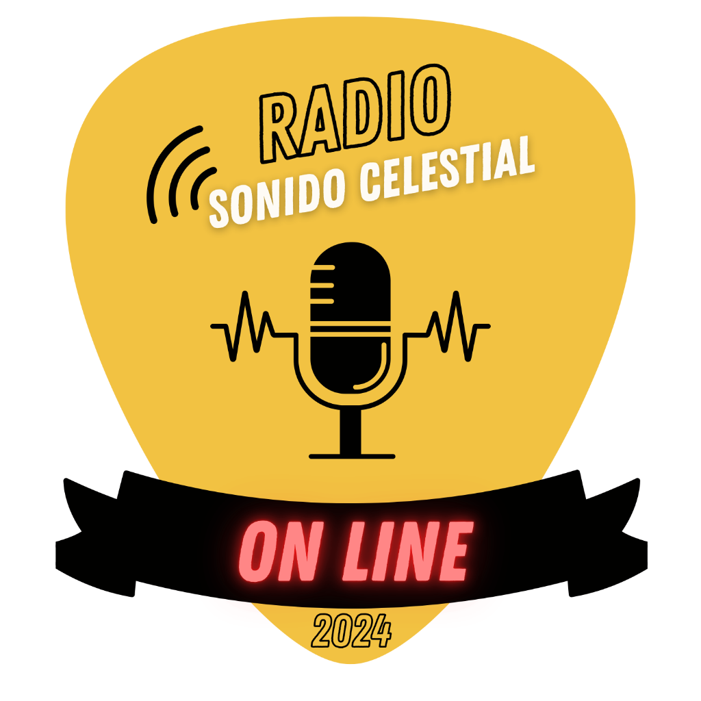

# UI IMPROVEMENTS v2.0 — Radio Sonido Celestial

**Fecha:** 5 de junio de 2026  
**Rol:** Diseñador UI/UX especializado en apps de radio y música  
**Inspiración:** Spotify, Deezer, TuneIn Radio, YouTube Music  
**Principios rectores:** Simplicidad, accesibilidad, jerarquía visual, identidad de marca  

---

## 1. Diagnóstico de la interfaz actual

### Fortalezas (mantener)

| Elemento | Por qué funciona |
|----------|-----------------|
| Fondo oscuro (`#121212`) | Base neutra que hace brillar el contenido |
| Acento dorado (`#fcad04`) | Identidad de marca sólida, evoca calidez y cielo |
| Blur dinámico del álbum | Efecto envolvente, presente en Spotify/YT Music |
| Animación breathe en logo | Sutil, da vida sin ser distractora |
| Canvas de estrellas | Atmósfera única que diferencia la marca |
| Panel historial slide-up | Gestual, consistente con plataformas modernas |

### Debilidades (mejorar)

| Elemento | Problema |
|----------|----------|
| Header "REPRODUCIENDO DESDE RADIO" | Texto frío, sin personalidad ni tesela de marca |
| Mini-art + track-info abajo | Redundante con el arte principal; la tarjeta "Now Playing" de Spotify no tiene duplicados |
| Barra de progreso siempre al 100% | No comunica "en vivo" — parece congelada |
| Botones sociales (FB/WA) alineados con play | Confunden la jerarquía: un botón social no debería tener el mismo peso visual que el play |
| Botón share oculto en fila de volumen | Fácil de pasar por alto |
| Sin indicador EN VIVO | TuneIn y radio apps usan un badge animado para confirmar que el stream está activo |
| Sin extracción de color del álbum | Deezer y Spotify extraen colores dominantes para fondos gradientes |

---

## 2. Propuesta de sistema de diseño

### 2.1 Paleta de colores

```
--bg-primary:     #0a0a0f   (fondo principal, más profundo que #121212)
--bg-surface:     #1a1a24   (tarjetas y paneles, tono ligeramente azulado)
--bg-elevated:    #24243a   (elementos elevados como el historial)
--text-primary:   #ffffff
--text-secondary: #a0a0b8   (gris azulado más suave que #b3b3b3)
--accent-gold:    #fcad04   (SE MANTIENE — identidad de marca)
--accent-glow:    rgba(252, 173, 4, 0.35)
--live-red:       #ff3b30   (rojo vivo para el badge EN VIVO)
--overlay:        rgba(0, 0, 0, 0.6)
```

**Justificación:** El fondo se oscurece ligeramente para que el dorado y las portadas destaquen más. Los grises se vuelven azulados para evocar "cielo nocturno", reforzando "Sonido Celestial".

### 2.2 Tipografía (se mantiene)

```
font-family: 'Outfit', sans-serif;
```

Outfit se conserva porque:
- Es la identidad actual de la marca
- Tiene buena legibilidad en pantallas pequeñas
- Su estilo geométrico combina con una interfaz moderna

Se ajustan los pesos:
- Títulos principales: `font-weight: 700`
- Canción actual: `font-weight: 600`
- Metadatos secundarios: `font-weight: 400`
- Etiquetas (EN VIVO, historial): `font-weight: 500`

### 2.3 Radio de bordes

| Elemento | Ahora | Propuesto |
|----------|-------|-----------|
| Album art wrapper | `12px` | `20px` |
| Tarjeta Now Playing | — | `16px` (nueva) |
| Panel historial | `16px 16px 0 0` | `20px 20px 0 0` |
| Botón play | `50%` | `50%` (circular, se mantiene) |
| Mini-art en historial | `6px` | `8px` |

---

## 3. Rediseño del reproductor principal

### 3.1 Header rediseñado

```
┌──────────────────────────────────────┐
│  ✦                       ◉ EN VIVO  │
│  Sonido Celestial         🕐         │
│  (logo + nombre)          (historial)│
└──────────────────────────────────────┘
```

**Cambios:**
- Izquierda: Logo pequeño (16x16px) + "Sonido Celestial" en gold
- Centro/Derecha: Badge "EN VIVO" animado con un punto rojo pulsante
- Derecha: Botón de historial (se mantiene pero se estiliza)

**Badge EN VIVO animado:**
```
[🔴  EN VIVO]
```
- Punto rojo con `animation: pulse-live 2s infinite`
- Fondo semitransparente con border-radius
- Texto en blanco, bold, tamaño 0.7rem

### 3.2 Álbum con presencia expandida

```
┌──────────────────────────────────────┐
│                                      │
│          ┌──────────────────┐        │
│          │                  │        │
│          │    PORTADA       │        │
│          │    (350x350)     │        │
│          │                  │        │
│          └──────────────────┘        │
│                                      │
│       ✦ Sutil glow extraído         │
│         del color dominante          │
│                                      │
└──────────────────────────────────────┘
```

**Cambios:**
- Border-radius: `20px` (más moderno)
- Sombra exterior extraída del color dominante de la portada (vía JS: `extractColorFromArt()`)
- Animación breathe se mantiene pero más suave: `scale(1.015)` en lugar de `scale(1.02)`
- El canvas de estrellas se mantiene detrás, opacidad reducida a `0.25` cuando hay portada

### 3.3 Tarjeta "Now Playing" rediseñada

```
┌──────────────────────────────────────┐
│  ┌────┐                              │
│  │    │  Nombre de la canción        │
│  │ 60 │  Artista                     │
│  │    │                              │
│  └────┘                              │
└──────────────────────────────────────┘
```

**La tarjeta actual tiene un problema:** muestra el mini-art + texto debajo del álbum grande, duplicando información. La propuesta unifica todo en una tarjeta compacta con glass-morphism.

```
┌──────────────────────────────────────┐
│ ┌────┐  ✦ Mañana en el Cielo        │
│ │    │  Artista: Grupo Sonido        │
│ │ 56 │  ◉ En reproducción             │
│ └────┘                               │
└──────────────────────────────────────┘
```

**Especificaciones:**
- Fondo: `rgba(255, 255, 255, 0.05)` con `backdrop-filter: blur(10px)`
- Borde: `1px solid rgba(255, 255, 255, 0.08)`
- Border-radius: `16px`
- Padding: `12px 16px`
- Mini-art: `56px`, border-radius `12px`
- Título: gold, `1rem`, bold, ellipsis
- Artista: `0.85rem`, `var(--text-secondary)`
- Indicador "En reproducción" con icono de onda animada

### 3.4 Barra de progreso animada

```
◉ EN VIVO  ───▓▓▓▓▓▓▓▓▓▓▓▓▓░░░░░░░░─  --:--
```

**Cambios:**
- Agregar una animación de "onda de audio" en la barra de progreso
- La barra no está al 100% fijo; tiene un gradiente animado que se mueve como un ecualizador suave
- Esto comunica visualmente "audio fluyendo" incluso siendo live radio

**Especificaciones CSS:**
```css
.progress-fill {
    background: linear-gradient(90deg, 
        var(--accent-gold), 
        #ffd700, 
        var(--accent-gold)
    );
    background-size: 200% 100%;
    animation: shimmer 3s ease-in-out infinite;
}
```

### 3.5 Controles principales

```
┌──────────────────────────────────────┐
│                                      │
│      [ Facebook ]  ⏹  [ WhatsApp ]   │
│                    (play)            │
│                                      │
│     ────🔉───────○──────── 🔊───      │
│                                      │
└──────────────────────────────────────┘
```

**Cambios en la disposición:**

Fila 1 — Redes sociales (arriba):
```
[🅕 Facebook]          [🅆 WhatsApp]
```
- Separados del play, más pequeños, con etiqueta
- Tamaño: `1.2rem` con badge circular sutil
- Alineados a izquierda y derecha (flex, space-between)
- Hover: color gold

Fila 2 — Play/Pause (centro, más grande):
```
                ▶️ / ⏸️
```
- Tamaño: `80px` (aumenta de 70px a 80px)
- Sombra gold glow más prominente en estado playing
- Micro-interacción: escala a `0.92` al presionar (más notoria que `0.95`)

Fila 3 — Volumen + Share:
```
🔉 ───────○─────── 🔊    [📤 Compartir]
```
- Slider de volumen más elegante (track más delgado: `3px`, thumb más grande: `14px`)
- Botón share con etiqueta "Compartir" en lugar de solo icono
- Colores: track `rgba(255,255,255,0.1)`, fill gold

---

## 4. Fondo dinámico con extracción de color

### 4.1 Algoritmo de color dominante

Actualmente el fondo usa `body::before` con `blur(30px) brightness(0.3)` sobre la portada. La mejora agrega una **capa de color extraída** entre el canvas y el blur.

```
CAPAS (de atrás hacia adelante):

1. Canvas estrellas (z-index: 0, opacity: 0.25)
2. Color extraído (z-index: 1, opacity: 0.3, gradiente)
   → linear-gradient(180deg, color-dominante, transparent)
3. Blur de portada (z-index: 2, opacity: 0.5)
   → body::before actual
4. Overlay oscuro (z-index: 2.5)
5. UI (z-index: 3+)
```

**Implementación propuesta en JS:**

```javascript
function extractAndApplyColor(imageUrl) {
    const img = new Image();
    img.crossOrigin = 'anonymous';
    img.onload = () => {
        const color = getDominantColor(img); // promedio de píxeles centrales
        playerContainer.style.setProperty('--extracted-color', color);
    };
    img.src = imageUrl;
}
```

Esto crea un gradiente de fondo que cambia con cada canción, como hace Deezer.

### 4.2 Paleta dinámica (opcional avanzado)

Extraer 2 colores dominantes y crear un gradiente:
```css
background: linear-gradient(
    135deg,
    var(--extracted-color-1),
    var(--extracted-color-2)
);
```

---

## 5. Indicador EN VIVO animado

### 5.1 Especificación visual

```
┌──────────┐
│ 🔴 EN VIVO │
└──────────┘
```

**Elemento:**
- Alto: `24px`
- Padding horizontal: `10px`
- Border-radius: `12px` (pill)
- Fondo: `rgba(255, 59, 48, 0.15)` con borde `1px solid rgba(255, 59, 48, 0.3)`
- Texto: blanco, `0.7rem`, `font-weight: 600`, `letter-spacing: 0.5px`
- Punto rojo: `8px`, border-radius `50%`, con animación pulse

### 5.2 Animación del punto

```css
@keyframes pulse-live {
    0%, 100% {
        opacity: 1;
        transform: scale(1);
    }
    50% {
        opacity: 0.6;
        transform: scale(0.85);
    }
}
```

### 5.3 Integración en el header

```
┌──────────────────────────────────────┐
│  ✦ Sonido Celestial   🔴 EN VIVO  🕐│
└──────────────────────────────────────┘
```

Flexbox: `space-between`. El badge se coloca a la derecha junto al botón de historial.

---

## 6. Mejora de botones sociales

### 6.1 De iconos sueltos a badges con etiqueta

```
ANTES:

[🅕]    [▶️]    [🅆]
(FB)    (play)  (WA)

DESPUÉS:

  [📘 Facebook]    [▶️]    [📱 WhatsApp]
```

### 6.2 Especificaciones

```css
.social-btn {
    display: inline-flex;
    align-items: center;
    gap: 6px;
    padding: 8px 16px;
    background: rgba(255, 255, 255, 0.06);
    border: 1px solid rgba(255, 255, 255, 0.1);
    border-radius: 20px;
    color: var(--text-secondary);
    font-size: 0.8rem;
    font-family: 'Outfit', sans-serif;
    cursor: pointer;
    transition: all 0.2s ease;
}

.social-btn:hover {
    background: rgba(255, 255, 255, 0.12);
    border-color: var(--accent-gold);
    color: var(--accent-gold);
}
```

---

## 7. Pantalla bloqueada (Media Session API)

### 7.1 Estado actual

El código ya usa `navigator.mediaSession.metadata` con título, artista y artwork. Sin embargo, el artwork usa siempre `logo.png`.

### 7.2 Mejora propuesta

Actualizar el artwork de Media Session con la portada real cuando esté disponible:

```javascript
if ('mediaSession' in navigator) {
    navigator.mediaSession.metadata = new MediaMetadata({
        title: title,
        artist: artist,
        album: 'Radio Sonido Celestial',
        artwork: [
            { src: albumArtUrl, sizes: '600x600', type: 'image/png' }
        ]
    });
}
```

Esto muestra la carátula real en la pantalla de bloqueo y en los controles del centro de notificaciones, en lugar del logo genérico.

### 7.3 Media Session actions

Agregar soporte para acciones desde pantalla bloqueada:

```javascript
navigator.mediaSession.setActionHandler('play', () => {
    if (isAndroid()) Android.play(streamUrl, ...);
    else audio.play();
});
navigator.mediaSession.setActionHandler('pause', () => {
    if (isAndroid()) Android.pause();
    else audio.pause();
});
```

Actualmente no hay handlers para `play` y `pause` desde Media Session — solo se actualiza la metadata. Esto significa que los controles de la pantalla de bloqueo y del centro de notificaciones pueden no responder en algunos navegadores/versiones de Android.

---

## 8. Mockup textual de la nueva interfaz

### 8.1 Estado REPRODUCIENDO

```
┌──────────────────────────────────────┐
│                                       │
│  ✦ Sonido Celestial   🔴 EN VIVO  🕐│
│                                       │
│          ┌──────────────────┐         │
│          │                  │         │
│          │   🎵 PORTADA     │         │
│          │   REAL DEL       │         │
│          │   ÁLBUM          │         │
│          │                  │         │
│          └──────────────────┘         │
│          (sutil glow dorado)          │
│                                       │
│  ┌──────────────────────────────┐     │
│  │ ┌──┐                        │     │
│  │ │56│  Amanecer en el Mar    │     │
│  │ └──┘  Los Cantores del      │     │
│  │       ◉ En reproducción     │     │
│  └──────────────────────────────┘     │
│                                       │
│  ───────▓▓▓▓▓▓▓▓▓▓▓░░░░░░░░────────  │
│  ◉ EN VIVO                    --:--   │
│                                       │
│  [📘 Facebook]    ▶️    [📱 WhatsApp]  │
│                                       │
│  🔉 ───────●─────── 🔊  [📤 Compartir]│
│                                       │
└──────────────────────────────────────┘
```

### 8.2 Estado PAUSADO

```
┌──────────────────────────────────────┐
│                                       │
│  ✦ Sonido Celestial   ⚫ EN PAUSA  🕐│
│                                       │
│          ┌──────────────────┐         │
│          │                  │         │
│          │   🎵 PORTADA     │         │
│          │   (sin glow,     │         │
│          │   opacidad 0.8)  │         │
│          │                  │         │
│          └──────────────────┘         │
│                                       │
│  ┌──────────────────────────────┐     │
│  │ ┌──┐                        │     │
│  │ │56│  Amanecer en el Mar    │     │
│  │ └──┘  Los Cantores del      │     │
│  │       ⏸ En pausa            │     │
│  └──────────────────────────────┘     │
│                                       │
│  ───────────░▒▒▒▒▒▒▒▒░──────────────  │
│  ⚫ EN PAUSA                   --:--  │
│                                       │
│  [📘 Facebook]    ▶️    [📱 WhatsApp]  │
│                                       │
│  🔉 ───────●─────── 🔊  [📤 Compartir]│
│                                       │
└──────────────────────────────────────┘
```

### 8.3 Historial desplegado

```
┌──────────────────────────────────────┐
│  ✦ Sonido Celestial   🔴 EN VIVO     │
│          ┌──────────────────┐         │
│          │   (offscreen,    │         │
│          │   cubierto por   │         │
│          │   el panel)      │         │
│          └──────────────────┘         │
│                                       │
│  ┌──────────────────────────────┐     │
│  │ ┌──┐  Últimas reproducciones ✕ │   │
│  │ └──┘                        │     │
│  ├──────────────────────────────┤     │
│  │ ┌──┐  Amanecer en el Mar    │     │
│  │ │44│  Los Cantores     Hace 5m│    │
│  │ └──┘                        │     │
│  │ ┌──┐  Luz de Luna           │     │
│  │ │44│  Grupo Solar      Hace 12m│   │
│  │ └──┘                        │     │
│  │ ┌──┐  Río de Estrellas      │     │
│  │ │44│  Coro Celestial  Hace 22m│   │
│  │ └──┘                        │     │
│  └──────────────────────────────┘     │
└──────────────────────────────────────┘
```

---

## 9. Resumen de cambios propuestos

| # | Componente | Cambio | Prioridad | Esfuerzo |
|---|------------|--------|-----------|----------|
| 1 | Header | Branding + badge EN VIVO animado | Alta | 2h |
| 2 | Album art | Border-radius 20px, glow dinámico | Alta | 1h |
| 3 | Now Playing | Glass-morphism card, unificar mini-art | Alta | 2h |
| 4 | Progress bar | Gradiente animado tipo shimmer | Alta | 1h |
| 5 | Controles | Separar sociales del play, agrandar play | Alta | 1.5h |
| 6 | Badge EN VIVO | Pill rojo con punto pulsante | Alta | 1h |
| 7 | Volumen | Track más delgado, thumb más grande | Media | 0.5h |
| 8 | Share | Botón visible con etiqueta | Media | 0.5h |
| 9 | Fondo dinámico | Extracción de color dominante vía canvas | Media | 3h |
| 10 | Media Session | Artwork real + handlers play/pause | Alta | 1h |
| 11 | Paleta colores | Ajustar grises a tono azulado | Baja | 0.5h |
| 12 | Micro-interacciones | Escala 0.92 en play, hover en sociales | Media | 0.5h |
| **Total** | | | | **~14h** |

---

## 10. Principios de diseño aplicados

| Principio | Aplicación |
|-----------|------------|
| **Jerarquía visual** | Play es el elemento central, social es secundario, historia es terciario |
| **Consistencia** | Un solo tipo de borde (20px), una paleta definida, una tipografía |
| **Feedback inmediato** | Escala al presionar, hover en sociales, animación breathe |
| **Contexto ambiental** | Fondo dinámico que cambia con la portada (inspirado en Spotify/Deezer) |
| **Claridad de estado** | Badge EN VIVO vs EN PAUSA, barra animada vs estática |
| **Toque humano** | Branding "Sonido Celestial" en lugar de "REPRODUCIENDO DESDE RADIO" |
| **Accesibilidad** | Texto con suficiente contraste, etiquetas en botones sociales, aria-labels |
| **Rendimiento consciente** | Animaciones solo con transform/opacity (compositor GPU), sin re-layouts |

---

## 11. Notas de implementación

### HTML — estructura general propuesta

```html
<main class="player-container">
    <!-- Header con branding y LIVE badge -->
    <div class="header-bar">
        <div class="header-brand">
            <span class="brand-name">Sonido Celestial</span>
        </div>
        <div class="header-right">
            <span class="live-badge">
                <span class="live-dot"></span>
                EN VIVO
            </span>
            <button id="history-btn" class="history-toggle">
                <i class="fas fa-clock-rotate-left"></i>
            </button>
        </div>
    </div>

    <!-- Album art -->
    <div class="art-container">
        <div class="album-art-wrapper">
            
        </div>
    </div>

    <!-- Now Playing card -->
    <div class="now-playing-card">
        
        <div class="now-playing-info">
            <div id="song-title">Cargando...</div>
            <div id="artist-name">Radio Sonido Celestial</div>
            <span class="playing-indicator">◉ En reproducción</span>
        </div>
    </div>

    <!-- Progress bar animada -->
    <div class="progress-container">
        <div class="progress-bar">
            <div class="progress-fill"></div>
        </div>
        <div class="progress-labels">
            <span class="live-indicator">
                <span class="live-dot-small"></span>
                EN VIVO
            </span>
            <span class="time-total">--:--</span>
        </div>
    </div>

    <!-- Controles -->
    <div class="controls-main">
        <div class="controls-row">
            <a href="..." class="social-btn">
                <i class="fab fa-facebook-f"></i>
                <span class="social-label">Facebook</span>
            </a>
            <button id="play-pause-btn" class="play-btn primary">
                <i class="fas fa-play"></i>
            </button>
            <a href="..." class="social-btn">
                <i class="fab fa-whatsapp"></i>
                <span class="social-label">WhatsApp</span>
            </a>
        </div>
        <div class="volume-row">
            <i class="fas fa-volume-down"></i>
            <input type="range" id="volume-slider" ...>
            <i class="fas fa-volume-up"></i>
            <button id="share-btn" class="share-button">
                <i class="fas fa-share-alt"></i>
                <span>Compartir</span>
            </button>
        </div>
    </div>

    <!-- History panel (se mantiene) -->
    <div id="history-panel" class="history-panel">...</div>
    <div id="history-overlay" class="history-overlay"></div>
</main>
```

### CSS — nuevas variables

```css
:root {
    --bg-primary: #0a0a0f;
    --bg-surface: #1a1a24;
    --bg-elevated: #24243a;
    --text-secondary: #a0a0b8;
    --live-red: #ff3b30;
    --extracted-color: #fcad04; /* se actualiza vía JS */
    --radius-card: 20px;
    --radius-surface: 16px;
    /* el resto se mantiene */
}
```

### Prioridades de implementación

| Orden | Componente | Depende de |
|-------|------------|------------|
| 1 | Paleta de colores y CSS variables | Nada |
| 2 | Badge EN VIVO + header branding | #1 |
| 3 | Now Playing card glass-morphism | #1 |
| 4 | Progreso animado | #1 |
| 5 | Controles rediseñados + botones sociales | #1 |
| 6 | Volumen + share | #5 |
| 7 | Media Session artwork real + handlers | Nada (JS puro) |
| 8 | Extracción de color dominante | #2 (usa la imagen del álbum) |
| 9 | Micro-interacciones y pulido | Todas las anteriores |

---

*Documento de diseño generado el 5 de junio de 2026. Las propuestas están priorizadas por impacto visual y esfuerzo de implementación.*
